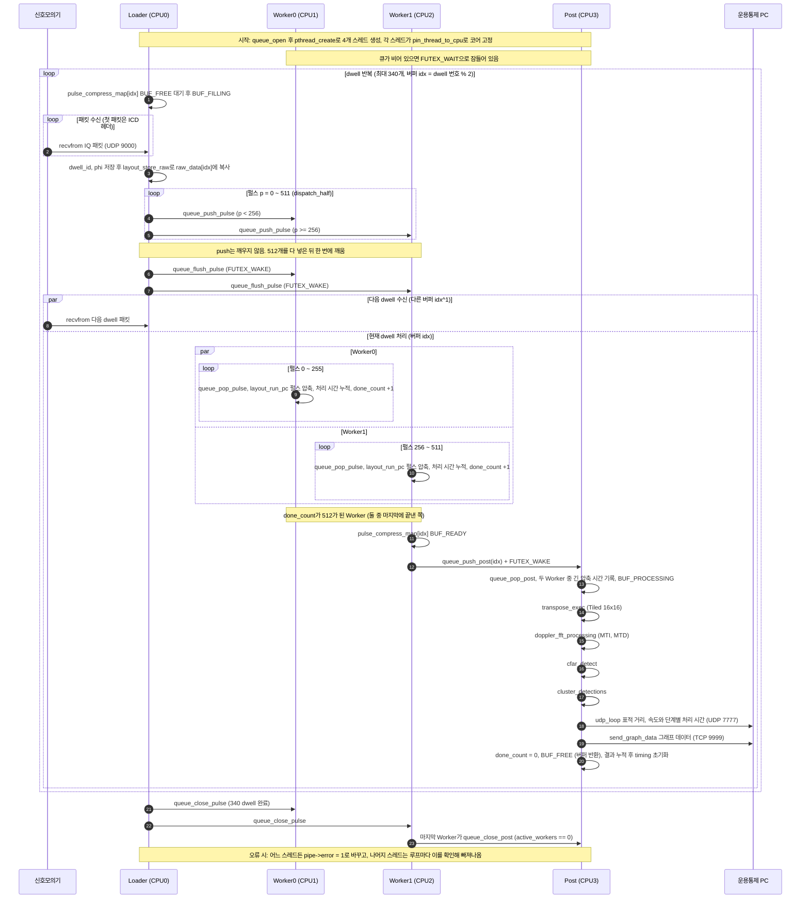
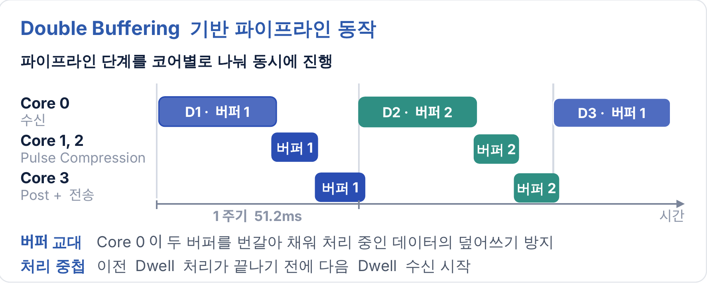

**팀 레포: https://github.com/TheSSEN-Observer**
---

# Radar Signal Processing Pipeline

> **라즈베리파이5 기반 실시간 레이더 신호처리 파이프라인**  
> Real-time Radar Signal Processing Pipeline on Raspberry Pi 5 (Cortex-A76, 4-core)

---

## 개요

UDP로 수신된 레이더 IQ 데이터를 실시간으로 처리하는 멀티스레드 파이프라인입니다.  
dwell 주기 **51.2ms** 이내에 Pulse Compress → Transpose → Doppler FFT → CFAR → Cluster까지 완료합니다.

```
UDP 수신 → Pulse Compress → Transpose → MTI → MTD(Doppler FFT) → CFAR → Cluster → 결과 전송
```

## 결과

신호처리 시간 **48.4ms → 16.4ms**, 51.2ms 주기 안에서 연속 처리

| 항목 | 선택 | 결과 |
|---|---|---|
| Worker 수 | 2개 | 20.9 → 16.4ms |
| 동기화 방식 | futex | lock-free 대비 CPU cycles 4.4배 적음 |
| 분배 방식 | Half (연속 블록) | 16.99 → 16.4ms |
| 메모리 배치 | PulseMajor | 53.7 → 16.4ms |
| Transpose | Tiled (16×16) | ArmPL 21.5 → 16.4ms |

---

## 파이프라인 구조

```
CPU 0  [loader ]  UDP 수신 및 버퍼 재조합
CPU 1  [worker0]  Pulse Compress (pulse 0~255)
CPU 2  [worker1]  Pulse Compress (pulse 256~511)
CPU 3  [post   ]  Transpose → Doppler FFT → CFAR → Cluster → 전송
```

- **더블 버퍼링**: loader가 다음 dwell을 수신하는 36ms 동안 worker/post가 이전 dwell을 처리
- **futex 큐**: loader → worker, worker → post 간 데이터 전달
- **atomic done_count**: 두 worker가 512개 pulse를 모두 완료하면 post에 자동 알림

### 처리 흐름 (시퀀스 다이어그램)

한 dwell이 수신부터 결과 전송까지 처리되는 흐름입니다.



### 처리 시간 (타이밍)



- 신호모의기는 51.2ms마다 dwell 하나를 보내고, Core 0은 이를 약 36ms 동안 수신합니다.
- 수신이 끝나면 Core 1, 2가 Pulse Compression(약 3.1ms), Core 3이 나머지 신호처리(약 13.3ms)를 이어서 합니다. 한 dwell의 신호처리 시간은 두 단계를 합친 **16.4ms**입니다.
- 버퍼를 두 개 번갈아 쓰기 때문에, Core 3이 이전 dwell을 처리하고 전송(약 12.85ms)하는 동안 Core 0은 다음 dwell을 다른 버퍼에 받습니다.
- 수신과 처리가 서로 다른 코어에서 겹쳐 진행되므로 두 시간을 더할 필요가 없고, 다음 dwell을 다 받기 전에 이전 dwell의 처리와 전송이 끝나 51.2ms 주기를 지킵니다.

---

## 폴더 구성

| 폴더 | 설명 |
|---|---|
| `pipeline_process_armpl/` | **최종 버전**. 4코어 파이프라인에 ArmPL FFT, 큐 방식 교체 구조, 메모리 배치, Transpose 최적화까지 적용 (이 README의 결과와 설명 기준) |
| `pipeline_process/` | 중간 버전. 4코어 파이프라인 구조만 적용 (FFT는 직접 구현, Worker 짝홀 분배) |
| `single_core/` | 초기 버전. 단일 스레드로 전체 신호처리 (FFT는 직접 구현) |
---
## 빌드 및 실행

### 의존성

```bash
# ARMPL (ARM Performance Libraries)
# https://developer.arm.com/Tools and Software/Arm Performance Libraries
# 기본 경로: /opt/arm/arm-performance-libraries

# FFTW3
sudo apt install libfftw3-dev
```

### 빌드

```bash
mkdir build && cd build
cmake ..
make -j$(nproc)
```

ARMPL 경로 변경 시:

```bash
cmake .. -DARMPL_DIR=/your/armpl/path
```

### 실행

```bash
# 기본 실행 (모든 옵션 기본값)
./radarBench metadata.csv

# 옵션 지정
./radarBench metadata.csv \
    --queue     futex       \   # futex | mutex | lockfree | usleep
    --transpose tiling      \   # tiling | comatcopy
    --dispatch  half        \   # half | evenodd
    --workers   2           \   # 1 | 2
    --layout    default         # default | legacy
```

### 성능 측정

```bash
# perf stat으로 측정
sudo perf stat ./radarBench metadata.csv --queue futex

# 5회 반복 측정
for i in {1..5}; do
    sudo perf stat ./radarBench metadata.csv --queue futex 2>> result.txt
done

# Ctrl+C 종료 시 신호처리 단계별 평균 시간 출력
```

---

## 프로젝트 구조

```
├── Inc/
│   ├── queue/
│   │   ├── queue_interface.h       # QueueType enum, PulseQueue/PostQueue 핸들
│   │   ├── futex/                  # futex 구현체
│   │   ├── mutex/                  # mutex 구현체
│   │   ├── lock_free/              # lockfree 구현체
│   │   └── usleep/                 # usleep 구현체
│   ├── transpose/
│   │   ├── transpose_interface.h   # TransposeType enum, Transpose 핸들
│   │   ├── transpose_tiling.h      # tiling 구현체
│   │   └── transpose_comatcopy.h   # comatcopy 구현체
│   ├── dispatch/
│   │   ├── dispatch_interface.h    # DispatchType enum, Dispatch 핸들
│   │   ├── dispatch_half.h
│   │   └── dispatch_evenodd.h
│   ├── layout/
│   │   ├── layout_interface.h      # LayoutType enum, Layout 핸들
│   │   ├── layout_default.h        # [pulse][range] 512×1001
│   │   └── layout_legacy.h         # [range][pulse] 1001×512
│   ├── settings/
│   │   ├── pipeline_set.h          # Pipeline, RdMapBuffer, DopplerBuffer
│   │   └── core_set.h              # pin_thread_to_cpu
│   ├── thread/
│   │   ├── loader_thread.h         # LoaderArgs, ICDHeader_t
│   │   ├── pulse_compress_thread.h # WorkerArgs
│   │   └── doppler_cfar_thread.h   # PostArgs
│   └── common.h                    # PipelineTiming, Accumulator
│
├── Src/
│   ├── radarBench.c                # main, AppState, 팩토리 초기화
│   ├── queue/                      # 큐 구현체
│   ├── transpose/                  # 전치 구현체
│   ├── dispatch/                   # 분배 구현체
│   ├── layout/                     # 레이아웃 구현체
│   ├── settings/                   # pipeline_set.c, core_set.c
│   ├── thread/                     # loader/worker/post 스레드
│   ├── pulse.c                     # Pulse Compress (FFTW3, ARMPL 기반)
│   ├── doppler.c               # Doppler FFT, MTI, MTD
│   ├── cfar.c                      # CFAR 탐지
│   └── cluster.c                   # 클러스터링
│
└── CMakeLists.txt
```

---

## 설계 원칙

### 팩토리 패턴 (Factory Pattern)

Queue, Transpose, Dispatch, Layout 모두 vtable(함수 포인터 구조체) 기반 팩토리 패턴으로 구현되었습니다. 동일한 바이너리에서 런타임에 구현체를 교체할 수 있어 공정한 성능 비교가 가능합니다.

```c
/* 생성 — 구현체 선택 */
PulseQueue *q = pulse_queue_create(QUEUE_FUTEX, cap);

/* 사용 — 구현체와 무관한 공통 인터페이스 */
queue_push_pulse(q, job);
queue_pop_pulse(q, &job);
queue_flush_pulse(q);
```

### 메모리 레이아웃 최적화

```
legacy  [range][pulse] 1001×512: PC에서 stride=512 접근 → 캐시 미스
default [pulse][range] 512×1001: PC에서 연속 접근 → 캐시 친화적
                                 + Transpose (~3.5ms) 추가
```

PC stride 접근 비용이 Transpose 3.5ms보다 크므로 default가 전체적으로 빠릅니다.

### atomic 동기화

```c
/* done_count: worker[0], worker[1]이 경쟁 없이 안전하게 증가 */
int done = atomic_fetch_add_explicit(
               &pipe->pulse_compress_map[raw_idx].done_count,
               1, memory_order_release) + 1;

if (done == 512) {
    atomic_thread_fence(memory_order_acquire);
    queue_push_post(pipe->post_q, pjob);
}
```

---

## 레이더 파라미터

| 파라미터 | 값 |
|---|---|
| 반송파 주파수 (fc) | 10 GHz |
| 샘플링 주파수 (fs) | 10 MHz |
| PRF | 10 kHz |
| 펄스 폭 | 1 μs |
| 스윕 대역폭 | 5 MHz |
| pulse 수 / dwell | 512 |
| fast-time samples | 1001 |
| dwell 주기 | 51.2 ms |

---

## 환경

| 항목 | 사양 |
|---|---|
| 하드웨어 | Raspberry Pi 5 (BCM2712) |
| CPU | Cortex-A76 × 4, 2.4GHz |
| OS | Linux (Ubuntu 24, 64-bit) |
| 컴파일러 | GCC (-O3 -ffast-math) |
| 수치 라이브러리 | ARMPL, FFTW3 |
| 성능 측정 | Linux perf |

---

## 📄 라이선스

본 프로젝트는 연구/학습 목적으로 작성되었습니다.
